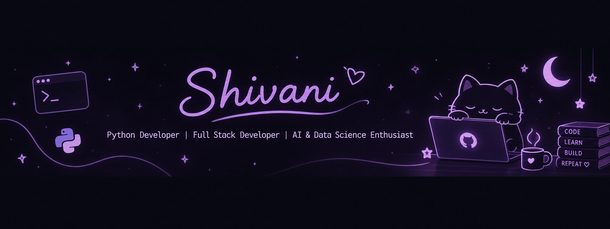

  

 

# Hey there, I'm Shivani 👋

---

##  👽 About Me 

I'm a developer interested in building practical solutions and exploring the intersection of technology and creativity.
Curious by nature, I enjoy figuring out how things work and turning ideas into something tangible.
Currently exploring full-stack development, Python, AI, and data science through hands-on projects.
Still learning, still building, and occasionally convincing my bugs that they're not supposed to be there.

---

## 👾 Tech Stack

  
  
  
  
  
  
  
  
  
  
  
  

---

## 🚀 Featured Projects

- 🔹 **[EMPLOX](YOUR_EMPLOX_REPOSITORY_LINK)**  
  Human Resource Management System for employee management, attendance, and HR operations — built using React, Node.js, Express, and MySQL.

- 🔹 **[FraudSense](YOUR_FRAUDSENSE_REPOSITORY_LINK)**  
  A project focused on fraud detection and identifying suspicious patterns through data analysis.

- 🔹 **[More Projects](https://github.com/shivanishini?tab=repositories)**  
  More experiments, side projects, and things built while learning.

---

## 📪 Let's Connect

  
  &nbsp;
  

---

  <i>Thank You ✨</i>

## 🐍 My Contribution Graph

  <picture>
    <source media="(prefers-color-scheme: dark)" srcset="https://raw.githubusercontent.com/shivanishini/shivanishini/output/github-contribution-grid-snake-dark.svg">
    <source media="(prefers-color-scheme: light)" srcset="https://raw.githubusercontent.com/shivanishini/shivanishini/output/github-contribution-grid-snake.svg">
    
  </picture>

