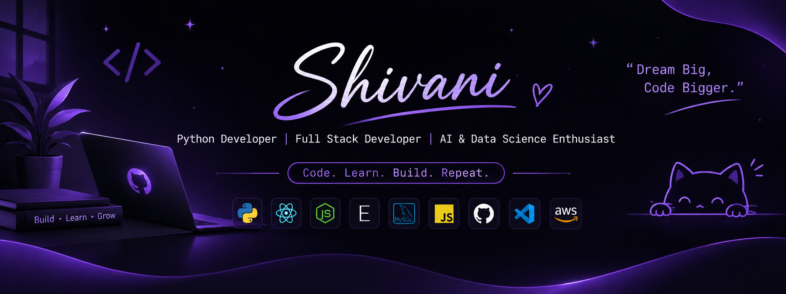

  

 

# Hi, I'm Shivani 👋

### Python Developer | Full Stack Developer | AI & Data Science Enthusiast

Building projects, learning new technologies, and turning ideas into reality.

---

## 👩‍💻 About Me

- 🔭 Currently working on **Full Stack Development projects**
- 🌱 Exploring **Artificial Intelligence, Machine Learning & Data Science**
- 💡 Interested in building practical applications that solve real-world problems
- ☁️ Learning about **AWS & Cloud Technologies**
- 🎯 Focused on improving my development skills and building projects consistently
- ⚡ I believe in learning by building

---

## 🛠️ Tech Stack

---

## 🚀 Featured Projects

<table>
<tr>
<td width="50%">

### 🏢 EMPLOX
**Human Resource Management System**

A full-stack HRMS designed to manage employee-related operations and HR workflows.

`React` `Node.js` `Express` `MySQL`

<a href="https://github.com/shivanishini/EMPLOX">View Repository →</a>

</td>
<td width="50%">

### 🕵️ FraudSense
**Fraud Detection Project**

A project focused on identifying and analyzing fraudulent patterns using data and programming.

`Python` `Data Analysis`

<a href="https://github.com/shivanishini/fraudsense">View Repository →</a>

</td>
</tr>
<tr>
<td width="50%">

### 📊 Sentiment Analyze
**Sentiment Analysis**

A project exploring sentiment analysis and text-based insights.

`Python` `Machine Learning`

<a href="https://github.com/shivanishini/sentiment-analyze">View Repository →</a>

</td>
<td width="50%">

### 🧪 More Projects
I'm continuously experimenting with new technologies, building projects, and improving my coding skills.

<a href="https://github.com/shivanishini?tab=repositories">Explore all repositories →</a>

</td>
</tr>
</table>
## 📊 GitHub Statistics

 

---

## 🌱 Currently Learning

- 🤖 AI & Machine Learning
- 📈 Data Science
- ☁️ Amazon Web Services (AWS)
- 🌐 Full Stack Development
- 🧠 Problem Solving & Software Development

---

## 🤝 Connect With Me

---

### ✨ Code. Learn. Build. Repeat. ✨

---

## 🐍 My Contribution Graph

  <picture>
    <source media="(prefers-color-scheme: dark)" srcset="https://raw.githubusercontent.com/shivanishini/shivanishini/output/github-contribution-grid-snake-dark.svg">
    <source media="(prefers-color-scheme: light)" srcset="https://raw.githubusercontent.com/shivanishini/shivanishini/output/github-contribution-grid-snake.svg">
    
  </picture>

